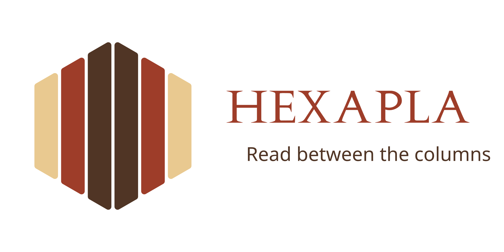
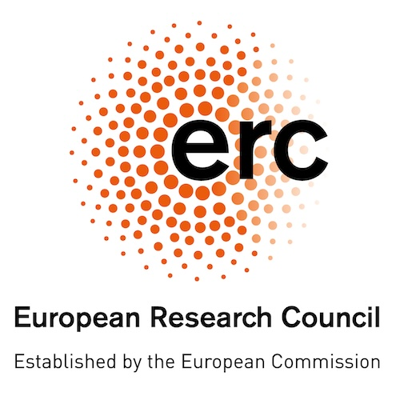

.. start-badges

|pypi| |tests| |docs| |python| |license|

.. |pypi| image:: https://img.shields.io/pypi/v/hexapla?color=blue
   :alt: PyPI
   :target: https://pypi.org/project/hexapla/

.. |tests| image:: https://github.com/rbturnbull/hexapla/actions/workflows/tests.yml/badge.svg
   :alt: Tests
   :target: https://github.com/rbturnbull/hexapla/actions/workflows/tests.yml

.. |docs| image:: https://github.com/rbturnbull/hexapla/actions/workflows/docs.yml/badge.svg
   :alt: Docs
   :target: https://rbturnbull.github.io/hexapla/

.. |python| image:: https://img.shields.io/pypi/pyversions/hexapla
   :alt: Python versions
   :target: https://pypi.org/project/hexapla/

.. |license| image:: https://img.shields.io/badge/license-Apache%202.0-blue
   :alt: Licence: Apache 2.0
   :target: https://github.com/rbturnbull/hexapla/blob/main/LICENSE

.. end-badges

.. start-summary

Hexapla builds static websites for reading and exploring word-aligned manuscript texts.

It takes a project's TEI transcriptions, CoNLL-U parses and word-alignment links and builds a site with:

- **verse-by-verse reading**, with dependency trees, an interlinear and an alignment matrix for each verse;
- a **bilingual lexicon** of every lemma and its translation equivalents;
- **translation insights**: how grammar carries over between the languages, and what each text leaves out;
- a **review queue** of the least confident links and parses;
- a **page for each manuscript**, described from its TEI header.

The name comes from Origen's Hexapla, which set versions of the Old Testament side by side in columns.

.. end-summary

Documentation: https://rbturnbull.github.io/hexapla/

.. start-example

Example
=======

.. image:: https://raw.githubusercontent.com/rbturnbull/bilingual-navigator/main/theme/bicross-navigator-logo.jpg
   :alt: The Bilingual Navigator
   :width: 220px
   :target: https://rbturnbull.github.io/bilingual-navigator/

The `Bilingual Navigator <https://rbturnbull.github.io/bilingual-navigator/>`_ is a Hexapla site of bilingual New
Testament manuscripts from the BICROSS project: Greek, Latin, Coptic, Arabic and Gothic. Its project, with the
config, TEI transcriptions, parses and alignments it is built from, is at
https://github.com/rbturnbull/bilingual-navigator.

.. end-example

.. start-installation

Installation
============

Hexapla needs Python 3.11 or later. Install it from PyPI:

.. code-block:: bash

    pip install hexapla

or the latest version from GitHub:

.. code-block:: bash

    pip install git+https://github.com/rbturnbull/hexapla

With `uv <https://docs.astral.sh/uv/>`_, install it as a command-line tool, or run it without installing:

.. code-block:: bash

    uv tool install hexapla
    uvx hexapla build project-config.yaml --output site

Check that it works with ``hexapla --version``.

.. end-installation

.. start-usage

Usage
=====

A project is a folder, usually its own repository, with a config file. Paths in the config are relative to the
config file:

.. code-block:: yaml

    theme:
      name: BICROSS Navigator
      logo: theme/logo.svg            # optional: the Hexapla logo by default
      variables: theme/variables.scss # optional: Bootstrap variables (.scss) or extra CSS (.css)
      about: theme/about.md           # optional: an about page (Markdown)
      assets: theme/assets            # optional: images and files for the about page
      licence: CC-BY-NC-SA-4.0        # SPDX id: the site, parses and links

    manuscripts:
      bezae-greek:
        tei: bezae/Bezae-Greek.xml
        parsing: bezae/Bezae-Greek-John20.conllu
      bezae-latin:
        tei: bezae/Bezae-Latin.xml
        parsing: bezae/Bezae-Latin-John20.conllu
        parsing_licence: CC-BY-4.0    # optional: overrides the site licence for this parse

    alignments:
      bezae:
        name: Codex Bezae             # optional: from the TEI's <msName> by default
        manuscripts: [bezae-greek, bezae-latin]   # the links file's source, then target
        links: bezae/Bezae-John20-aligned.jsonl
        licence: CC-BY-4.0            # optional: overrides the site licence for these links

Everything about a manuscript comes from the TEI header of its transcription (TEI P5, chapter 10): the language
(``<text xml:lang>``, required), ``msName``, the shelfmark, ``altIdentifier`` numbers (``GA``, ``VL``, ``TM`` for
Trismegistos), ``origDate``, the ``msContents/summary``, the transcribers and the licence. A TEI file's own licence
overrides the site's for that transcription.

Check the project, then build the site:

.. code-block:: bash

    hexapla validate project-config.yaml
    hexapla build project-config.yaml --output site
    python -m http.server --directory site 8000     # then open http://localhost:8000

.. end-usage

.. start-files

Making the CoNLL-U and links files
==================================

Hexapla reads standard formats, so the parses and alignments can come from any tool: CoNLL-U files with one sentence
per verse, and links in JSON Lines (or Ugarit-style YAML) between the words of two parses with the same ``sent_id``.
Two tools written for this work make them conveniently with LLM agents:

- `MCParser <https://github.com/rbturnbull/llmparser>`_ lemmatises and parses each text into CoNLL-U:

  .. image:: https://raw.githubusercontent.com/rbturnbull/hexapla/main/docs/_static/mcparser-logo.svg
     :alt: MCParser
     :width: 240px
     :target: https://github.com/rbturnbull/llmparser

  .. code-block:: bash

      pip install --pre mcparser
      mcparser init bezae-john20-grc.yaml -o Bezae-Greek-John20.conllu -s greek-treebank.conllu
      mcparser run Bezae-Greek-John20.conllu -s greek-treebank.conllu

- `MCAligner <https://github.com/rbturnbull/llmaligner>`_ links the words of two parses:

  .. image:: https://raw.githubusercontent.com/rbturnbull/hexapla/main/docs/_static/mcaligner-logo.svg
     :alt: MCAligner
     :width: 240px
     :target: https://github.com/rbturnbull/llmaligner

  .. code-block:: bash

      pip install git+https://github.com/rbturnbull/llmaligner
      mcaligner run -s grc=Bezae-Greek-John20.conllu -s lat=Bezae-Latin-John20.conllu \
          -a pred=grc,lat,Bezae-John20-aligned.jsonl --target pred --guidelines grc-lat

The docs explain the input formats and how the pieces fit together.

.. end-files

.. start-github-pages

GitHub Pages
============

Build and deploy a project's site on every push with the Hexapla GitHub Action:

.. code-block:: yaml

    name: pages
    on: { push: { branches: [main] }, workflow_dispatch: {} }
    permissions: { contents: read, pages: write, id-token: write }
    concurrency: { group: pages, cancel-in-progress: false }
    jobs:
      deploy:
        runs-on: ubuntu-latest
        environment: { name: github-pages, url: "${{ steps.site.outputs.page_url }}" }
        steps:
          - uses: actions/checkout@v4
          - id: site
            uses: rbturnbull/hexapla@main
            with:
              config: project-config.yaml

Set the repository's Pages source to "GitHub Actions". The action installs Hexapla from its own checkout, builds the
site and deploys it. With ``deploy: "false"`` it only builds the site, for example to check a pull request.

.. end-github-pages

.. start-development

Development
===========

Hexapla uses `uv <https://docs.astral.sh/uv/>`_:

.. code-block:: bash

    git clone https://github.com/rbturnbull/hexapla.git
    cd hexapla
    uv sync --all-groups                                  # the package, and the dev and docs dependencies
    uv run pytest                                         # 100% coverage is required
    uv run sphinx-build -W docs docs/_build/html          # the documentation
    uv run hexapla build tests/data/project/project.yaml --output site    # the test project's site

.. end-development

Acknowledgements
================

.. start-acknowledgements

Hexapla was developed as part of the BICROSS project (‘The Significance of Bilingual Manuscripts for Detecting
Cross-Language Interaction in the New Testament Tradition’), which has received funding from the European Research
Council (ERC) under the European Union’s Horizon Europe Research and Innovation Programme (Grant Agreement
No. 101043730 – BICROSS – ERC-2021-COG). Funded by the European Union. Views and opinions expressed are however those
of the author only and do not necessarily reflect those of the European Union or the European Education and Culture
Executive Agency (EACEA). Neither the European Union nor EACEA can be held responsible for them.

.. end-acknowledgements

Author
======

`Robert Turnbull <https://robturnbull.com>`_ (Melbourne Data Analytics Platform, University of Melbourne)
